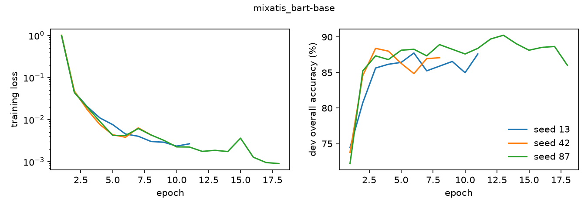
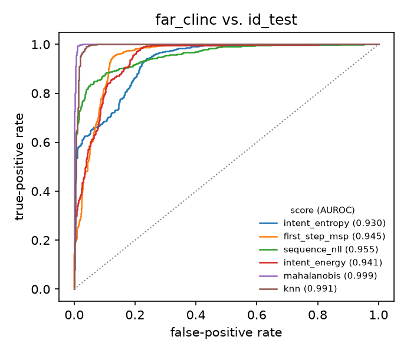
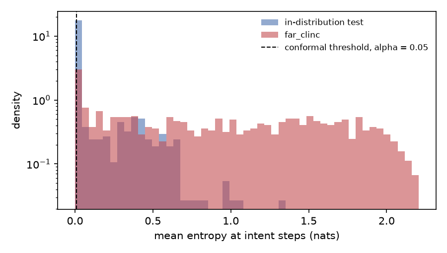
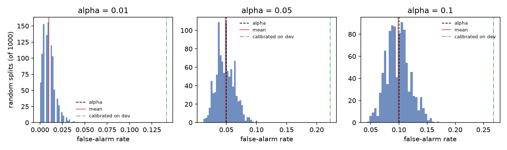

# GEMIS reimplementation + conformal OOD detection

[](https://github.com/ALI-AL-MARJANI/Multi-Intent-BART/actions/workflows/ci.yml)
[](LICENSE)

An independent reimplementation of GEMIS (Li & Zhu, 2026), a BART model that
generates the intents and slot spans of a multi-intent utterance as one
sequence, and a study of out-of-distribution (OOD) detection on top of it with
split-conformal calibration.

The paper has no public code. Part 1 measures how close this reimplementation
gets to the published numbers. Part 2 is not in the paper.

## TL;DR

<!-- TLDR:BEGIN -->
Test-set results of this repository (*ours*, mean ± standard deviation over seeds) next to the numbers published by Li & Zhu (2026) (*paper*, number of runs not reported).

| Experiment | Seeds | Slot F1 (ours) | Paper | Intent acc. (ours) | Paper | Overall acc. (ours) | Paper |
|---|---|---|---|---|---|---|---|
| `mixatis_bart-base` | 3 | 87.44 ± 1.13 | 88.5 | 80.92 ± 0.87 | 81.3 | 50.89 ± 0.46 | 52.5 |

OOD detection, `mixatis_bart-base`, `far_clinc` (n=1000) against the in-distribution test split (n=828), 3 seed(s). False-alarm rate of the conformal threshold at alpha = 0.05 (target: at most 0.05).

| Score | AUROC ↑ | FPR@95TPR ↓ | False alarms, threshold from random halves of test | False alarms, threshold from dev |
|---|---|---|---|---|
| `intent_entropy` | 0.9280 ± 0.0021 | 0.2476 ± 0.0158 | 0.0480 ± 0.0003 | 0.2069 ± 0.0137 |
| `first_step_msp` | 0.9375 ± 0.0083 | 0.1296 ± 0.0109 | 0.0482 ± 0.0003 | 0.1184 ± 0.0105 |
| `sequence_nll` | 0.9548 ± 0.0031 | 0.2991 ± 0.0116 | 0.0484 ± 0.0002 | 0.2460 ± 0.0512 |
| `intent_energy` | 0.9284 ± 0.0171 | 0.1948 ± 0.0039 | 0.0482 ± 0.0001 | 0.1643 ± 0.0212 |
| `mahalanobis` | 0.9985 ± 0.0001 | 0.0068 ± 0.0007 | 0.0477 ± 0.0001 | 0.1284 ± 0.0092 |
| `knn` | 0.9915 ± 0.0006 | 0.0217 ± 0.0012 | 0.0477 ± 0.0001 | 0.1176 ± 0.0025 |
| `negative_length` | 0.8944 ± 0.0000 | 0.2536 ± 0.0000 | 0.0398 ± 0.0000 | 0.0676 ± 0.0000 |

Setup: macOS-15.6.1-arm64-arm-64bit, 16.0 GB, device `mps`, torch 2.8.0, transformers 4.57.1; official MixATIS split (test n=828); seeds 13, 42, 87; greedy decoding. Sources: [`results/nlu/summary.json`](results/nlu/summary.json), [`results/ood/summary.json`](results/ood/summary.json). Runs that are configured but not done are listed as `TBD (run pending)` in [Results](#results).
<!-- TLDR:END -->

## Motivation

Multi-intent spoken language understanding is usually solved with a classifier
for intents and a tagger for slots. GEMIS casts both as generation with a
pointer network, which removes the fixed number of intents. A deployed
understanding model also has to notice utterances it was not trained for, and
OOD detection is mostly studied for discriminative intent classifiers. This
repository asks two questions: can the GEMIS results be reproduced from the
paper alone, and which OOD score works for such a generative model when the
false-alarm rate has to be controlled?

## Method

### Model

```
utterance ──► BART encoder ──► H_e ───────────────┐
                                │                 │ pointer scores over the N input positions
                                ▼                 ▼
 previous outputs ──► BART decoder with AoA ──► h_t ──► [ W·h_t ; H~·h_t ] ──► softmax over L + N classes
                                                          │
                                                          └ label scores over L = 1 + #intents + #slot types
```

**Target sequence.** `intent_1 … intent_p  start_1 end_1 slot_1 … start_q end_q slot_q </s>`.
For `please play got the time and add my hands to travelling playlist`:
`PlayMusic AddToPlaylist 2 5 track 7 9 entity_name 10 11 playlist`.
`start` and `end` are word indices (0-based, end exclusive). They are not
generated as tokens: the model points at the first subword of the word, or at
the final `</s>` for an end after the last word.

**Pointer head** (paper Eq. 5-6, `src/gemis/models/pointer.py`):

```
H~  = α · MLP(H_e) + (1 − α) · E_x
ŷ_t = softmax([ W h_t ; H~ h_t ])
```

`E_x` are the input token embeddings and `W` the embeddings of the label
tokens, which are initialised with the mean embedding of the label's subwords.

**Attention-over-attention** (paper Eq. 8-10, `src/gemis/models/aoa.py`),
which replaces the cross-attention of every decoder layer:

```
CAM = softmax(Q K_enc^T / √d_k)                    cross-attention map, T × N
SAM = softmax(Q K_dec^T / √d_k + causal mask)      self-attention map,  T × T
A   = softmax(Q K_enc^T / √d_k + SAM · CAM / √d_k)
```

AoA adds no parameters; the projections are the pretrained BART ones.

### Differences from the paper

The paper leaves several points open. Each choice below is a deviation or an
assumption, not a claim about what the authors did.

| Point | Paper | This repository |
|---|---|---|
| Position convention | Example `2 5 track` for "Got The Time"; inclusive/exclusive and word/subword level not stated | Word index, 0-based, exclusive end, pointer on the first subword |
| `α` in the pointer | Hyperparameter, value not reported | Learned scalar, `sigmoid`, initialised at 0.5; it stayed between 0.502 and 0.503 in every run (`pointer_alpha` in `seed*_train.json`), so in practice α = 0.5 |
| First term of the AoA logits | Written without `1/√d_k` | Scaled, as the pretrained attention weights require |
| Pointer MLP size, warmup, weight decay, gradient clipping | Not reported | 512, 1% linear warmup, 0.01, 1.0 |
| Learning rate | Chosen in {1e-5, 2e-5, 3e-5} on dev | 2e-5, no search |
| Epochs | 30 | At most 30, early stopping after 5 epochs without dev improvement |
| Label inventory | Not stated | Training split only (labels unseen in training cannot be predicted) |
| Number of runs | Not reported | 3 seeds, mean ± standard deviation |
| MultiATIS / MultiSNIPS | Constructed with BERT NSP, threshold not reported, data not released | Not reproduced (see [Limitations](#limitations-and-threats-to-validity)) |

Since `SAM · CAM` is a convex combination of probability vectors, the AoA term
is bounded by `1/√d_k` (0.125 for BART). Its effect on the attention logits is
small by construction; the ablation below measures what it changes.

### OOD scores and conformal calibration

All scores come from one greedy decoding pass (`src/gemis/ood/scores.py`) and
are oriented so that higher means more likely OOD.

| Score | Definition | Origin |
|---|---|---|
| `intent_entropy` | Mean entropy of the output distribution over the steps that emit an intent | this repository |
| `first_step_msp` | 1 − maximum probability at the first step | Hendrycks & Gimpel (2017) |
| `sequence_nll` | Length-normalised negative log-likelihood of the greedy output | Ren et al. (2023) |
| `intent_energy` | −logsumexp of the intent logits at the first step | Liu et al. (2020) |
| `mahalanobis` | Mahalanobis distance of the mean encoder state to the training features (one Gaussian) | Lee et al. (2018), class-agnostic variant |
| `knn` | Distance to the 10th nearest training feature after L2 normalisation | Sun et al. (2022) |
| `negative_length` | Minus the number of words; uses no model (trivial baseline) | this repository |

A score is turned into a decision with split-conformal calibration
(`src/gemis/ood/calibrator.py`): given `n` in-distribution calibration scores,
an utterance is flagged when its score exceeds the
`⌈(n+1)(1−α)⌉`-th smallest of them. If calibration and test utterances are
exchangeable, the probability of flagging an in-distribution utterance is at
most `α` (Vovk et al., 2005; Bates et al., 2023). The guarantee is marginal
over the calibration draw and says nothing about the detection rate.

## Experimental protocol

**Datasets.** MixATIS and MixSNIPS, the cleaned versions released with AGIF
(Qin et al., 2020), with their official splits.

| Dataset | Train | Dev | Test | Intents | Slot types (train) |
|---|---|---|---|---|---|
| MixATIS | 13,162 | 759 | 828 | 17 | 74 |
| MixSNIPS | 39,776 | 2,198 | 2,199 | 7 | 39 |

113 of the 828 MixATIS test utterances contain an intent or slot type that
never occurs in the training split (`atis_day_name`, `flight`,
`stoploc.airport_code`, `booking_class`). A model whose labels come from the
training data cannot get them fully right, which caps overall accuracy at
86.4% on this test set.

**Metrics** (`src/gemis/training/metrics.py`), as in AGIF and GL-GIN:
slot F1 is the micro-averaged F1 over exact `(start, end, type)` spans, equal
to conlleval chunk F1 (tested against `seqeval`); intent accuracy is the share
of utterances whose predicted intent set equals the gold set; overall accuracy
requires both the intent set and all slots to be correct.

**Baselines.** Published AGIF and GL-GIN numbers as reference points; a BART
model without AoA, without the pointer network (positions generated as
classes) and with randomly initialised label embeddings as ablations.

**OOD evaluation sets.** In-distribution: the test split. Far-OOD: the 1,000
out-of-scope test queries of CLINC150 (Larson et al., 2019), lowercased and
stripped of sentence punctuation to match the in-distribution formatting.
Near-OOD: a model is retrained without any utterance containing
`AddToPlaylist` or `SearchScreeningEvent`; test utterances carrying one of
them are the OOD set. Metrics: AUROC, AUPR with OOD as positive (AUPR-out) and
with in-distribution as positive (AUPR-in), FPR at 95% TPR, each with a 95%
bootstrap interval, and the false-alarm rate at the conformal threshold for
`α ∈ {0.01, 0.05, 0.1}`.

**Conformal validity.** Two calibration schemes are compared. *Dev-calibrated*:
threshold from the dev split, false-alarm rate measured on the test split; the
dev split also selects the checkpoint, so exchangeability is not guaranteed.
*Random splits of test*: 1,000 random halves of the test split as calibration
and evaluation sets, exchangeable by construction.

**Hyperparameters.** [`configs/_base.yaml`](configs/_base.yaml) and one file
per experiment in [`configs/`](configs). Seeds: 13, 42, 87.

## Results

<!-- RESULTS:BEGIN -->
### Part 1: reproduction of the NLU results

Source: [`results/nlu/summary.md`](results/nlu/summary.md), built by `scripts/aggregate_results.py` from the per-seed files in `results/nlu/<experiment>/`.

Test-set results. *Ours*: mean ± sample standard deviation over seeds. *Paper*: Li & Zhu (2026), Tables 3 and 5, number of runs not reported.

| Experiment | Seeds | Slot F1 (ours) | Paper | Intent acc. (ours) | Paper | Overall acc. (ours) | Paper |
|---|---|---|---|---|---|---|---|
| mixatis_bart-base | 3 | 87.44 ± 1.13 | 88.5 | 80.92 ± 0.87 | 81.3 | 50.89 ± 0.46 | 52.5 |
| mixatis_bart-base_no-aoa | 0 | TBD (run pending) | n/a | TBD (run pending) | n/a | TBD (run pending) | n/a |
| mixatis_bart-base_no-pointer | 0 | TBD (run pending) | n/a | TBD (run pending) | n/a | TBD (run pending) | n/a |
| mixatis_bart-base_random-label-init | 0 | TBD (run pending) | n/a | TBD (run pending) | n/a | TBD (run pending) | n/a |
| mixatis_bart-large | 0 | TBD (run pending) | 89.2 | TBD (run pending) | 81.4 | TBD (run pending) | 53.4 |
| mixsnips_bart-base | 0 | TBD (run pending) | 96.6 | TBD (run pending) | 96.5 | TBD (run pending) | 84.3 |
| mixsnips_bart-base_holdout | 0 | TBD (run pending) | n/a | TBD (run pending) | n/a | TBD (run pending) | n/a |
| mixsnips_bart-large | 0 | TBD (run pending) | 97.4 | TBD (run pending) | 98.1 | TBD (run pending) | 87.4 |

Dev vs. test, and the test utterances whose intents and slot types all occur in the training split (the others cannot be fully correct with a training-split label inventory):

| Experiment | Dev overall acc. (selected epoch) | Test overall acc. | Test utterances with an unseen label | Slot F1, seen labels only | Intent acc., seen labels only | Overall acc., seen labels only |
|---|---|---|---|---|---|---|
| mixatis_bart-base | 88.80 ± 1.30 | 50.89 ± 0.46 | 113 of 828 | 87.52 ± 0.57 | 93.01 ± 1.01 | 58.93 ± 0.53 |



### Part 2: OOD detection and conformal calibration

Source: [`results/ood/summary.md`](results/ood/summary.md), built from `results/ood/<experiment>/seed*/metrics.json`; per-utterance scores are in the `scores.csv` files next to them.

**mixatis_bart-base**: `far_clinc` (n=1000) vs. `id_test` (n=828), 3 seed(s). OOD is the positive class.

| Score | AUROC ↑ | AUPR-out ↑ | AUPR-in ↑ | FPR@95TPR ↓ |
|---|---|---|---|---|
| intent_entropy | 0.9280 ± 0.0021 | 0.9386 ± 0.0028 | 0.9275 ± 0.0011 | 0.2476 ± 0.0158 |
| first_step_msp | 0.9375 ± 0.0083 | 0.9248 ± 0.0172 | 0.9502 ± 0.0041 | 0.1296 ± 0.0109 |
| sequence_nll | 0.9548 ± 0.0031 | 0.9665 ± 0.0023 | 0.9427 ± 0.0022 | 0.2991 ± 0.0116 |
| intent_energy | 0.9284 ± 0.0171 | 0.9113 ± 0.0439 | 0.9411 ± 0.0069 | 0.1948 ± 0.0039 |
| mahalanobis | 0.9985 ± 0.0001 | 0.9986 ± 0.0001 | 0.9986 ± 0.0001 | 0.0068 ± 0.0007 |
| knn | 0.9915 ± 0.0006 | 0.9872 ± 0.0011 | 0.9933 ± 0.0005 | 0.0217 ± 0.0012 |
| negative_length | 0.8944 ± 0.0000 | 0.8490 ± 0.0000 | 0.9112 ± 0.0000 | 0.2536 ± 0.0000 |

**mixatis_bart-base**: conformal false-alarm rate on `id_test` (target: alpha).

| Score | alpha | Calibrated on dev | Random splits of test (mean of 1000) |
|---|---|---|---|
| intent_entropy | 0.01 | 0.1345 ± 0.0302 | 0.0098 ± 0.0002 |
| intent_entropy | 0.05 | 0.2069 ± 0.0137 | 0.0480 ± 0.0003 |
| intent_entropy | 0.1 | 0.2613 ± 0.0140 | 0.0985 ± 0.0002 |
| first_step_msp | 0.01 | 0.0568 ± 0.0360 | 0.0097 ± 0.0002 |
| first_step_msp | 0.05 | 0.1184 ± 0.0105 | 0.0482 ± 0.0003 |
| first_step_msp | 0.1 | 0.1687 ± 0.0210 | 0.0989 ± 0.0002 |
| sequence_nll | 0.01 | 0.0616 ± 0.0210 | 0.0097 ± 0.0002 |
| sequence_nll | 0.05 | 0.2460 ± 0.0512 | 0.0484 ± 0.0002 |
| sequence_nll | 0.1 | 0.3724 ± 0.0562 | 0.0989 ± 0.0010 |
| intent_energy | 0.01 | 0.1123 ± 0.0147 | 0.0097 ± 0.0001 |
| intent_energy | 0.05 | 0.1643 ± 0.0212 | 0.0482 ± 0.0001 |
| intent_energy | 0.1 | 0.2045 ± 0.0025 | 0.0982 ± 0.0003 |
| mahalanobis | 0.01 | 0.0254 ± 0.0012 | 0.0091 ± 0.0000 |
| mahalanobis | 0.05 | 0.1284 ± 0.0092 | 0.0477 ± 0.0001 |
| mahalanobis | 0.1 | 0.2275 ± 0.0042 | 0.0982 ± 0.0003 |
| knn | 0.01 | 0.0185 ± 0.0014 | 0.0091 ± 0.0000 |
| knn | 0.05 | 0.1176 ± 0.0025 | 0.0477 ± 0.0001 |
| knn | 0.1 | 0.1763 ± 0.0024 | 0.0981 ± 0.0002 |
| negative_length | 0.01 | 0.0048 ± 0.0000 | 0.0051 ± 0.0000 |
| negative_length | 0.05 | 0.0676 ± 0.0000 | 0.0398 ± 0.0000 |
| negative_length | 0.1 | 0.1244 ± 0.0000 | 0.0849 ± 0.0000 |

**mixatis_bart-base**: dev-calibrated false-alarm rate at alpha = 0.05, by whether the `id_test` utterance carries an intent or slot type that never occurs in the training split.

| Score | With an unseen label (n=113) | Seen labels only (n=715) |
|---|---|---|
| intent_entropy | 0.9705 ± 0.0204 | 0.0862 ± 0.0154 |
| first_step_msp | 0.4454 ± 0.0223 | 0.0667 ± 0.0093 |
| sequence_nll | 0.8378 ± 0.0803 | 0.1524 ± 0.0472 |
| intent_energy | 0.4307 ± 0.0184 | 0.1221 ± 0.0231 |
| mahalanobis | 0.0767 ± 0.0184 | 0.1366 ± 0.0082 |
| knn | 0.0059 ± 0.0102 | 0.1352 ± 0.0029 |






<!-- RESULTS:END -->

### Analysis

The tables above are generated; this section is written by hand from them and
from the per-seed files they cite.

**NLU, MixATIS, bart-base (3 seeds).** Intent accuracy (80.92 ± 0.87) is
within one standard deviation of the paper's bart-base number (81.3). Slot F1
(87.44 ± 1.13) and overall accuracy (50.89 ± 0.46) are 1.1 and 1.6 points
below it. The paper reports neither its number of runs nor a variance, so
these gaps cannot be tested; they are compatible with the differences listed
in "Differences from the paper" (no learning-rate search in particular).

**Dev is much easier than test.** The dev overall accuracy at the selected
epoch is 88.80 ± 1.30, the test overall accuracy 50.89 ± 0.46. Two causes are
visible in the files:

* 113 of the 828 test utterances carry a label that never occurs in the
  training split; 108 of them have the intent `atis_day_name`
  (`most_missed_intents` in `seed*_test.json`). Restricted to the 715 other
  utterances, intent accuracy rises to 93.01 ± 1.01, close to its dev value.
  A typical failure: *"what day of the week do flights from nashville to tacoma
  fly on and also flight number from houston to dallas"* is predicted as
  `atis_flight` + `atis_flight_no`, and `day` is tagged
  `depart_time.period_of_day` (`seed13_test_predictions.jsonl`).
* Overall accuracy on those 715 utterances is still 58.93 ± 0.53. The
  remaining errors are mostly slots: in every seed 60-64% of the wrongly
  parsed test utterances have the right intents and wrong slots
  (`intent_correct` / `overall_correct` in `seed*_test_predictions.jsonl`).
  `city_name` has the most errors in every seed (130-154 missed spans,
  `error_analysis` in `seed*_test.json`), mostly confusions with
  `fromloc.city_name` / `toloc.city_name`; for example, in *"list california airports , list la and ..."* the model
  tags `la` as `fromloc.city_name` instead of `city_name`.

Dev accuracy is a weak guide to test accuracy here: seed 87 reached the
highest dev score (90.25, epoch 13), seed 42 stopped improving on dev at
epoch 3 (88.41), yet seed 42 has the higher test overall accuracy (51.21 vs.
51.09; `seed*_train.json`, `seed*_test.json`).

**Far-OOD (CLINC150 out-of-scope).** The two encoder-feature scores separate
CLINC from MixATIS almost perfectly (Mahalanobis AUROC 0.9985, k-NN 0.9915);
the four decoder scores reach 0.928 to 0.955. The length-only baseline
already reaches 0.894: CLINC queries are short single requests, MixATIS
utterances are concatenations of two or three requests. Part of what every
score detects is therefore utterance length, and this experiment says little
about OOD utterances that look like in-distribution ones. The held-out-intent
experiment (near-OOD) is the one that addresses this; it is not run yet.

**Conformal validity.** With the threshold computed on random halves of the
test split, the false-alarm rate at alpha = 0.05 is between 0.0476 and 0.0484
for every model-based score, matching the theoretical value (the length
baseline is lower, 0.0398, because its many tied values make the threshold
conservative): the procedure is
implemented correctly. With the threshold computed on the dev split, the
false-alarm rate on test is 0.118 to 0.246 for the model-based scores: dev and
test are not exchangeable, and the guarantee does not hold in this
deployment-like setting. The split by label status shows where the excess
comes from for the decoder scores: `intent_entropy` flags 97% of the 113 test
utterances with a label unseen in training and 8.6% of the others. These
"false alarms" are mostly utterances that ask for an intent the model was
never trained on, which an OOD detector arguably should flag; the 8.6% on the
other utterances is still above alpha. The encoder-feature scores behave the
other way round: they almost never flag the unseen-label utterances (k-NN
0.6%) and flag 13-14% of the others, i.e. they measure input novelty, not
label novelty. The length baseline, which does not depend on the model, has a
dev-calibrated false-alarm rate of 0.068.

## Limitations and threats to validity

* **This is not a faithful reproduction of the paper's numbers.** No code or
  hyperparameter file was released; the choices in "Differences from the
  paper" may differ from the authors'. A gap to the published numbers can come
  from those choices, from the missing learning-rate search, or from the
  backbone size.
* **MultiATIS and MultiSNIPS are not reproduced.** The paper's best-known
  numbers (e.g. 98.8 intent accuracy on MultiSNIPS) are on datasets the
  authors constructed and did not release. `scripts/construct_dataset.py`
  implements the published algorithm, but the threshold is unreported, so the
  output is a different dataset and no result on it is claimed.
* **Rows marked "TBD (run pending)" have not been run.** Nothing in this
  README is an expected or estimated value. At this point only
  `mixatis_bart-base` has results: no MixSNIPS run, no ablation, no near-OOD
  run, no bart-large run.
* **Resumed runs.** Every committed run was interrupted (out of memory or
  machine sleep) and resumed from its last epoch, so none is bit-identical to
  an uninterrupted run with the same seed. The first six epochs of seed 13
  ran on a slightly earlier version of the code; see
  [`docs/devlog.md`](docs/devlog.md).
* **Seeds.** Three seeds give a rough standard deviation, not a tight
  interval. Rows with fewer seeds say so.
* **Far-OOD is an easy setting.** CLINC150 out-of-scope queries are about
  topics unrelated to flight booking or the SNIPS domains, and they are much
  shorter than the multi-intent utterances (length alone gives AUROC 0.894).
  High AUROC there does not transfer to utterances that are close to the
  training intents; the held-out-intent experiment is the relevant one for
  that.
* **The MixATIS test split is not purely in-distribution.** 108 of its 828
  utterances ask for `atis_day_name`, an intent absent from training. They
  are counted as in-distribution in every OOD table, as the dataset defines
  them, which lowers the AUROC of scores that react to unknown intents.
* **The near-OOD set mixes known and unknown intents.** A held-out utterance
  in MixSNIPS usually also contains one or two in-distribution intents, so the
  task is to notice that *part* of the utterance is unsupported.
* **Conformal calibration controls false alarms only**, on average over
  calibration sets, and only if deployment data is exchangeable with the
  calibration data. It gives no guarantee on the share of OOD utterances
  detected, and none under distribution shift of the in-distribution data.
* **No latency study.** Decoding re-runs the decoder on the full prefix at
  each step (no key/value cache); `utterances_per_second` in the result files
  is indicative only.

## Reproduce

[`RUNBOOK.md`](RUNBOOK.md) lists the exact command, output files, hardware and
time for every table. In short:

```bash
pip install -e ".[dev]"
python scripts/download_data.py --dataset mixatis mixsnips
pytest                                                                # CPU, offline, about 10 s
sh scripts/run_experiment.sh configs/mixatis_bart-base.yaml 13 42 87  # train, evaluate, OOD-score
python scripts/aggregate_results.py && python scripts/make_figures.py
python scripts/update_readme.py                                       # copy the tables into this README
```

Using a trained checkpoint:

```python
import torch
from gemis.data.alignment import encode_source
from gemis.data.decoding import decode_frame
from gemis.models.gemis import GEMISModel

model, tokenizer, _ = GEMISModel.from_checkpoint("checkpoints/mixatis_bart-base/seed13/best.pt")
source = encode_source("show me flights from boston to denver and what is fare code h".split(), tokenizer)
ids = torch.tensor([source.input_ids])
output = model.eval().generate(ids, torch.ones_like(ids))
print(decode_frame(output.sequences[0], model.label_space, source.word_starts))
```

Output with the seed 13 checkpoint (word indices are 0-based, end exclusive):

```
Frame(intents=frozenset({'atis_flight', 'atis_airfare'}), slots=frozenset({(4, 5, 'fromloc.city_name'), (12, 13, 'fare_basis_code'), (6, 7, 'toloc.city_name')}))
```

## Repository structure

```
configs/            one YAML per experiment, all inheriting from _base.yaml
data/ood/           CLINC150 out-of-scope test queries (far-OOD set)
docs/devlog.md      defects found in v0.1 and claims that were withdrawn
results/            committed outputs: per-seed JSON/CSV, summaries, figures, published reference numbers
scripts/            train, evaluate, score_ood, evaluate_ood, aggregate_results, make_figures, update_readme, data preparation
src/gemis/
  data/             AGIF parsing, word-to-subword alignment, targets, decoding to frames, Algorithm 1
  models/           AoA cross-attention, decoder layer, pointer head, GEMISModel
  ood/              OOD scores, conformal calibration, detection metrics
  training/         trainer, evaluation loop, metrics, error analysis
tests/              offline tests on a toy dataset with a tiny random BART
```

The tests include: the word-to-subword alignment on BART's tokenizer, an
oracle check that the training targets decode back to the gold frames,
equivalence of the modified decoder layer with stock BART when the AoA term is
switched off, invariance of the outputs to batch padding, an end-to-end
overfit and checkpoint reload, span F1 against `seqeval`, and false-alarm
control of the conformal threshold on exchangeable scores.

## References

1. L. Li, W. Zhu. *A Generative Model for Joint Multiple Intent Detection and Slot Filling.* 2026. [arXiv:2602.08322](https://arxiv.org/abs/2602.08322)
2. M. Lewis et al. *BART: Denoising Sequence-to-Sequence Pre-training for Natural Language Generation, Translation, and Comprehension.* ACL 2020. [arXiv:1910.13461](https://arxiv.org/abs/1910.13461)
3. H. Yan et al. *A Unified Generative Framework for Various NER Subtasks.* ACL 2021. [arXiv:2106.01223](https://arxiv.org/abs/2106.01223) (pointer formulation on BART)
4. L. Qin et al. *AGIF: An Adaptive Graph-Interactive Framework for Joint Multiple Intent Detection and Slot Filling.* Findings of EMNLP 2020. [arXiv:2004.10087](https://arxiv.org/abs/2004.10087), [code and MixATIS / MixSNIPS](https://github.com/LooperXX/AGIF)
5. L. Qin et al. *GL-GIN: Fast and Accurate Non-Autoregressive Model for Joint Multiple Intent Detection and Slot Filling.* ACL 2021. [arXiv:2106.01925](https://arxiv.org/abs/2106.01925)
6. C.-W. Goo et al. *Slot-Gated Modeling for Joint Slot Filling and Intent Prediction.* NAACL 2018. [code and data](https://github.com/MiuLab/SlotGated-SLU)
7. S. Larson et al. *An Evaluation Dataset for Intent Classification and Out-of-Scope Prediction.* EMNLP 2019. [arXiv:1909.02027](https://arxiv.org/abs/1909.02027), [data](https://github.com/clinc/oos-eval)
8. D. Hendrycks, K. Gimpel. *A Baseline for Detecting Misclassified and Out-of-Distribution Examples in Neural Networks.* ICLR 2017. [arXiv:1610.02136](https://arxiv.org/abs/1610.02136)
9. W. Liu et al. *Energy-based Out-of-distribution Detection.* NeurIPS 2020. [arXiv:2010.03759](https://arxiv.org/abs/2010.03759)
10. K. Lee et al. *A Simple Unified Framework for Detecting Out-of-Distribution Samples and Adversarial Attacks.* NeurIPS 2018. [arXiv:1807.03888](https://arxiv.org/abs/1807.03888)
11. A. Podolskiy et al. *Revisiting Mahalanobis Distance for Transformer-Based Out-of-Domain Detection.* AAAI 2021. [arXiv:2101.03778](https://arxiv.org/abs/2101.03778)
12. Y. Sun et al. *Out-of-Distribution Detection with Deep Nearest Neighbors.* ICML 2022. [arXiv:2204.06507](https://arxiv.org/abs/2204.06507)
13. J. Ren et al. *Out-of-Distribution Detection and Selective Generation for Conditional Language Models.* ICLR 2023. [arXiv:2209.15558](https://arxiv.org/abs/2209.15558)
14. V. Vovk, A. Gammerman, G. Shafer. *Algorithmic Learning in a Random World.* Springer, 2005.
15. A. N. Angelopoulos, S. Bates. *A Gentle Introduction to Conformal Prediction and Distribution-Free Uncertainty Quantification.* 2021. [arXiv:2107.07511](https://arxiv.org/abs/2107.07511)
16. S. Bates et al. *Testing for Outliers with Conformal p-values.* Annals of Statistics 51(1), 2023. [arXiv:2104.08279](https://arxiv.org/abs/2104.08279)
17. F. den Hengst et al. *Conformal Intent Classification and Clarification for Fast and Accurate Intent Recognition.* Findings of NAACL 2024. [arXiv:2403.18973](https://arxiv.org/abs/2403.18973)
